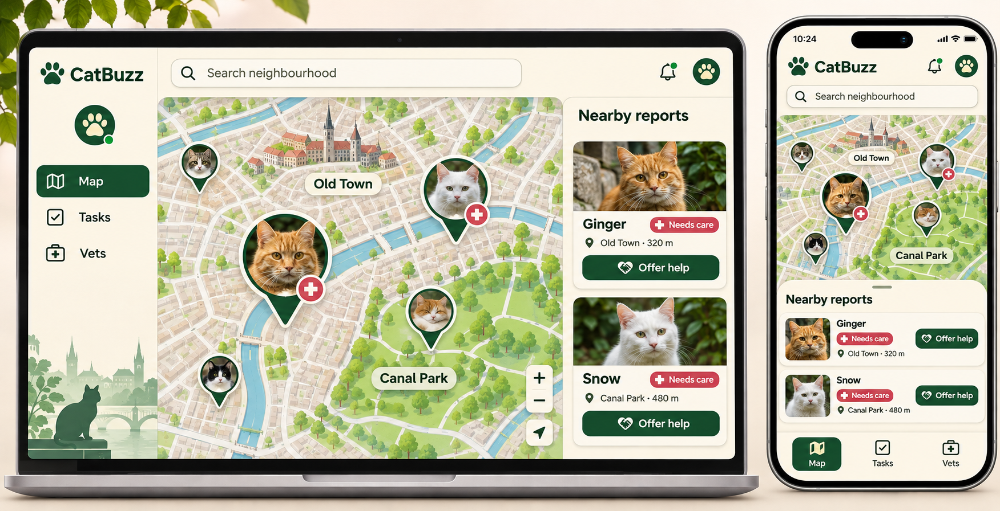

# 🐾 CatBuzz

**Free tools for people who look out for stray cats.**

You spot a cat that needs help on your way home. A neighbor can check on it tomorrow, and another volunteer may be able to arrange transport. CatBuzz is a free, Persian-language web project that aims to give everyone involved one place to record what the cat needs, coordinate who can help, and follow up afterward.



*An early design concept for the CatBuzz homepage on desktop and mobile.*

## 🐱 What we're building

| Step | What it will help people do |
| --- | --- |
| 📍 Spot a need | Report a cat or colony that needs help while keeping exact locations private. |
| 🤝 Coordinate care | Help local volunteers work out who can take the next step. |
| 📝 Follow up | Record what happened and what still needs attention. |

## 🚧 Project status


CatBuzz is in development. The current code includes a local development stack, a database schema and API, email-based account activation, an account page, and professional credential review. Cat reporting, volunteer coordination, and care tracking are planned workflows. See the [product requirements](docs/02-PRD.md) for the scope of each phase.


## 💻 Run locally


Install Node.js 20.9 or later and Docker Desktop. Run these commands in PowerShell from the project folder after cloning the repository.


```powershell
npm ci
Copy-Item .env.example .env.local
npm run infra:up
npm run db:migrate
npm run dev
```


Open [localhost:3000](http://localhost:3000). Test activation emails are available in [Mailpit](http://127.0.0.1:58025). To load sample data, run `npm run db:seed` in another terminal. Keep `.env.local` on your machine and use local development values.


## 🤝 Tests and contributions


- `npm run check` runs type checking, linting, unit tests, and the production build.
- `npm run test:db` runs database tests against the local services.
- `npm run test:e2e` runs Playwright tests. Run `npx playwright install chromium` once to install the test browser.


Use [GitHub Issues](https://github.com/ss-sami-ss/CatBuzz/issues) to report bugs or suggest changes. Include steps to reproduce a bug or explain who would benefit from a proposed change. Keep exact cat locations and personal contact details out of issue reports.


## 📚 Documentation


- [Project goals](docs/01-BRD.md) and [product requirements](docs/02-PRD.md)
- [Architecture](docs/05-ARCHITECTURE.md), [data model](docs/06-DATA-MODEL.md), and [API contracts](docs/07-API-CONTRACTS.md)
- [Security and access](docs/09-SECURITY-AND-ACCESS.md) and [development and operations](docs/13-DEVOPS.md)
- [Decisions and risks](docs/03-DECISIONS-AND-RISKS.md), [task list](TASKS.md), and [changelog](CHANGELOG.md)

