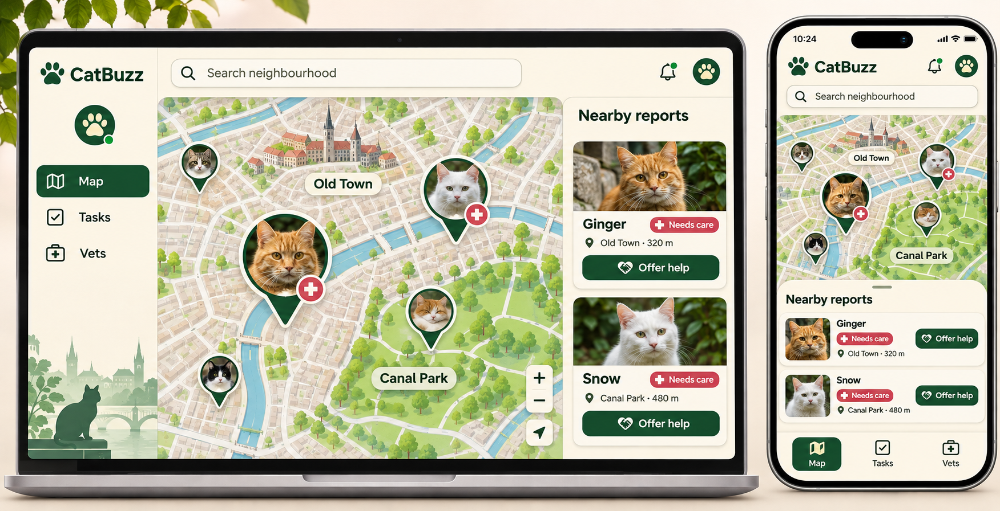

# UX، سیستم طراحی و صفحهٔ اول

## مرجع تصویر

این تصویر با imagegen ساخته شده و داده و جغرافیای آن نمونه است. قلم، فاصله، نوشته و جزئیات نقشه باید در اجرای واقعی بازبینی شوند. عنوان «نزدیک شما» در صورت رد دسترسی مکان به «در محدودهٔ انتخابی» تغییر می‌کند.

## ساختار ناوبری

دسکتاپ دارای sidebar سمت راست، ناحیهٔ جست‌وجو و اعلان، نقشه و لیست کنار نقشه است. موبایل دارای نوار پایین نقشه، مأموریت‌ها، ثبت، پیام‌ها و پروفایل است. گروه‌ها، جامعه، دامپزشکان، تقویم، حمایت، سرپرستی و نگهداری موقت، و مشاوره از منوی اصلی یا پروفایل در دسترس‌اند. هیچ قابلیت صرفاً به دلیل نبود در نوار پایین مخفی و غیرقابل‌دسترسی نشود.

## صفحهٔ اول

- جست‌وجوی محله با پیشنهاد قابل‌انتخاب و نمایش محدودهٔ فعال.
- فیلترهای همه، فوری، غذا و آب، درمان و واگذاری؛ فیلتر کلینیک و کلونی از کنترل لایه‌ها.
- محدودهٔ تقریبی گربه، marker دارای تصویر/آیکون و clustering متناسب با zoom.
- دکمهٔ «جست‌وجو در این محدوده» پس از حرکت نقشه برای کنترل مصرف درخواست.
- انتخاب marker و کارت لیست همگام باشد؛ URL می‌تواند شناسهٔ گربه و فیلتر را نگه دارد، مختصات دقیق خصوصی در URL قرار نگیرد.
- خلاصهٔ پرونده شامل نام، نیاز، آخرین مشاهده، وضعیت مراقبت و CTA «مشاهده پرونده» یا «کمک می‌کنم».
- «ثبت گزارش» از مشاهدهٔ گربهٔ جدید و نیاز روی پروندهٔ موجود پشتیبانی کند.
- وظیفهٔ امروز فقط اگر وظیفه‌ای وجود دارد نمایش داده شود؛ دادهٔ نمایشی در نسخهٔ واقعی باقی نماند.
- در موبایل bottom sheet با حالت بسته/خلاصه/باز، کلید بستن و مدیریت focus پیاده شود.

## مسیرهای کلیدی

1. ثبت گربه → بررسی موارد مشابه → عکس و مشخصات → مکان تقریبی عمومی و مکان اصلی خصوصی → انتشار پرونده.
2. ثبت نیاز → نوع و فوریت → شواهد → تأیید گزارش → انتخاب مأموریت → پذیرش → ثبت نتیجه.
3. حمایت → هدف و وضعیت مالی → مبلغ و هزینهٔ سرویس → پرداخت → رسید → گزارش مصرف.
4. درخواست عمومی پزشک → شرح/عکس → پیشنهاد پزشک → انتخاب → فضای خصوصی مشاوره → نتیجه.
5. ویزیت خصوصی → پزشک/تعرفه → زمان → پرداخت → جلسه → نتیجه و پیگیری.
6. مشاورهٔ رفتار → معرفی خدمت → درخواست یا دعوت اختیاری → رضایت خود فرد → تخصیص → تماس → پایان/لغو.
7. واگذاری → ثبت درخواست → بررسی → ملاقات/تحویل → پیگیری → پایان یا بازگشت.
8. نگهداری موقت → انتخاب نوع (گربهٔ خانگی یا خانهٔ موقت گربهٔ خیابانی) → فیلتر محدوده/تاریخ/شیوه → کارت نگهدارنده → انتخاب گربه و تاریخ → انتظار تأیید → نمایش تماس → تحویل → گزارش روزانه → بازگشت یا تحویل به سرپرست دائم → نظر دوطرفه. صفحهٔ «نگهدارنده شوید» فرم پروفایل، شرایط خانه، دسترس‌پذیری و وضعیت بررسی را دارد. جزئیات در [CARE](11-CARE-AND-COUNSELING.md).

## Design tokens پیشنهادی

| Token | مقدار اولیه |
|---|---|
| primary | #145A3B |
| background | #F7F4EE |
| surface | #FFFFFF |
| text | #18231D |
| muted | #5F6B63 |
| urgent | #A83E24 |
| border | #DEDAD2 |
| radius | 8 / 12 / 16 / 24px |
| spacing | 4 / 8 / 12 / 16 / 24 / 32px |
| typography | Vazirmatn برای فارسی؛ system fallback تا بارگذاری |
| target | حداقل 44×44px برای کنترل لمسی |

زبان طراحی CatBuzz انیمیشن‌محور است (سریع، معنادار، صیقل‌خورده؛ D20). motion tokens، قواعد حرکت، جهت‌های RTL و مشخصات جابه‌جایی صفحه، bottom sheet/Drawer/Dialog و stagger در [طراحی حرکت](18-MOTION-DESIGN.md) هستند. اندازه‌گیری کنتراست و پیشنهاد توکن `border-strong` هم در همان سند آمده است.

کنتراست واقعی همهٔ ترکیب‌ها اندازه‌گیری شود. این مقادیر نقطهٔ شروع‌اند. breakpoint پیشنهادی 768 و 1200 پیکسل است و روی عرض 360 تا 1440 آزمون شود. فهرست تصاویر و نقشه نباید باعث اسکرول افقی صفحه شوند.

## قرارداد کامپوننت‌ها

UI پایه شامل Button، Input، Select، Checkbox، Dialog، Drawer، Tabs، Toast و Skeleton است. اجزای محصول شامل CatCard، NeedBadge، MissionCard، ClinicCard، DonationProgress، InvoiceCard، ConsentForm، ScheduleEditor، CaregiverCard، PlacementTimeline و DailyReportCard هستند. CaregiverCard فقط DTO عمومی را نمایش می‌دهد و به جای نشان تأیید، امتیاز، تعداد نظر و سابقه را با متن «CatBuzz هویت یا کیفیت نگهدارندگان را تأیید نمی‌کند» نشان می‌دهد (D21). نوار «پرداخت داخل برنامه فعال نیست» تا تصمیم D19 روی هزینهٔ اعلام‌شده دیده می‌شود.

View دادهٔ آماده و callback intent می‌گیرد. CatCard با کلیک، intent انتخاب را ارسال می‌کند؛ درخواست API و مجوز دسترسی داخل کارت قرار نمی‌گیرد. اشتراک کامپوننت زمانی ایجاد شود که کاربرد مشترک واقعی دارد. فایل بزرگ برای تمام قابلیت‌های محصول ایجاد نشود.

## حالت‌ها و دسترس‌پذیری

برای هر صفحه loading، empty، failure، offline، unauthorized و success تعریف شود. خطا کنار فیلد با ارتباط aria، focus قابل‌دیدن، ترتیب Tab منطقی، Escape و بازگشت focus در modal لازم است. برای نقشه، لیست معادل قابل‌استفاده با صفحه‌کلید ارائه شود. وضعیت فوری علاوه بر رنگ متن دارد. عکس alt مناسب و ویدئو کنترل پخش دارد.

پروندهٔ گربه تب‌های معرفی، نیازها/مأموریت‌ها، مراقبت و درمان، هزینه‌ها/فاکتورها و رسانه دارد. قسمت خصوصی پزشکی یا تماس فقط برای مجازها در سرور خوانده شود؛ پنهان‌کردن ظاهری یک تب کافی نیست.

## متن و اعتماد

نام واقعی افراد عمومی نیست. ادعای «تأییدشده» فقط همراه نوع تأیید نمایش داده شود. موارد نامشخص به‌صراحت «نامشخص» باشند. درخواست فوری زمان آخرین به‌روزرسانی و وضعیت پاسخ‌گویی را نشان دهد. رضایت مشاوره checkbox از پیش انتخاب‌شده نداشته باشد. ثبت هزینه با پرداخت موفق یا تأیید صحت فاکتور یکسان نمایش داده نشود.
